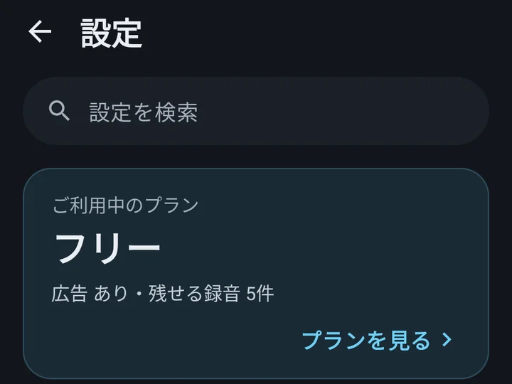
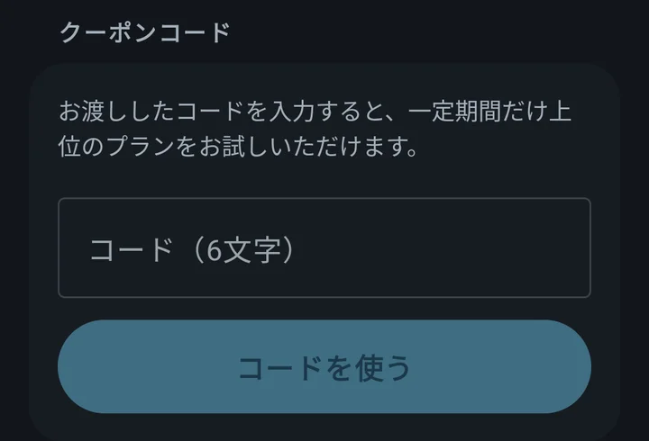
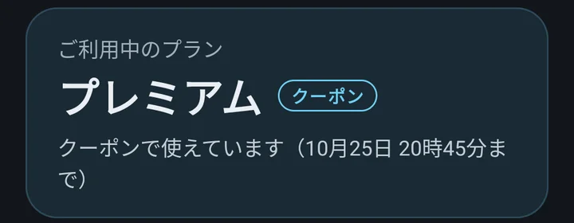
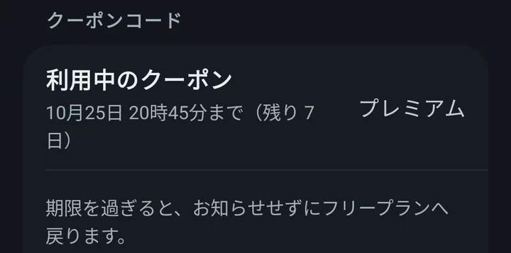

# クーポンの使い方

らじぽけ（Radio Pocket）

最終更新日: 2026年10月18日

---

## クーポンとは

らじぽけのクーポンは、6 文字のコードです。アプリに入れると、**入れてから決まった期間だけ、有料のプランの機能が使えます。**
どのプランを何日使えるかは、クーポンごとに決まっています。お知らせのときに、あわせてご案内します。

- 期間は、**クーポンを入れた時から**数えます
- 1 つのクーポンは、1 台の端末で 1 回だけ使えます
- **期間が終わると、自動で元のプランに戻ります。お金はかかりません**

## 入れ方

1. 画面のいちばん下の **「設定」** を開き、いちばん上のプランのカードの **「プランを見る」** を押します

   

2. 「アカウントとプラン」が開きます。下のほうへたどると **「クーポンコード」** があります
3. **「コード（6文字）」** の欄にコードを入れ、**「コードを使う」** を押します。大文字と小文字は、どちらで入れてもかまいません

   

4. その場でプランが変わります。いちばん上のカードに **「クーポン」** の印と、いつまで使えるかが出ます

   

## 期間が終わったら

期限の時刻を過ぎると、**お知らせせずに、自動で元のプランに戻ります。** 購入の手続きは何も起きず、お金はかかりません。

作ったものは消えません。お気に入り・頭出し・マーク・目覚ましの設定は残り、表示や利用が止まるだけです。
もう一度そのプランを使いたいときは、有料のプランにご加入いただけます（[料金](index.html#料金)）。

## よくある質問

### コードが入らないとき

- **6 文字かどうか**を確かめてください。数字の 0 と 1、英字の O・I・L は使っていません。似た字に見えるときは、ほかの字です
- 空白やハイフンは入っていてもかまいません（読み飛ばします）
- **同じクーポンは、1 台で 1 回だけです。** 前に一度入れた端末では「このコードは、この端末で使用済みです。」と出ます
- 「このコードは使えません。」と出るときは、打ち間違いがないかお確かめください
- 配るのを終えたクーポンは使えません（「このコードは無効になりました。」と出ます）

### 残りの期間を確かめたいとき

設定 →「プランを見る」の「クーポンコード」に、**「利用中のクーポン」** と、いつまで使えるか・残りの日数が出ます。

### 有料のプランにすでに入っているとき

クーポンを入れても、ご契約のプランはそのまま続きます。クーポンが終わったあとは、ご契約のプランに戻ります。

## お問い合わせ

わからないことがあれば、黒猫福家本舗の LINE アカウントでお気軽にお尋ねください。AI がお答えし、担当（人）に代わるときは、そうお伝えします。
アプリの 設定 →「情報とサポート」→「LINE で問い合わせる」からも開けます。

- 友だち追加: [https://line.me/R/ti/p/%40690yokig](https://line.me/R/ti/p/%40690yokig)
- [LINE でのお問い合わせのプライバシーポリシー](https://kuroneko-line.kuroneko-fukuya.workers.dev/privacy)

アプリの中の「意見箱」や、[トップのお問い合わせ](index.html#お問い合わせ)のメールからもお送りいただけます。
